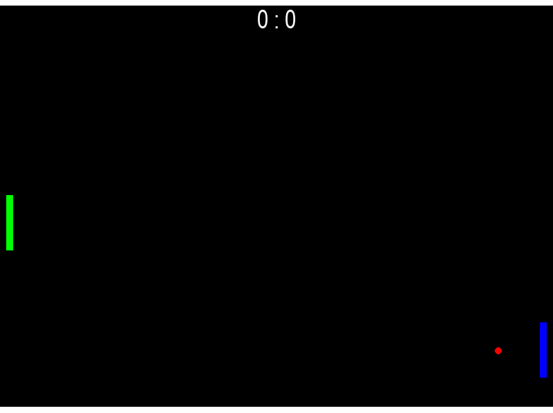
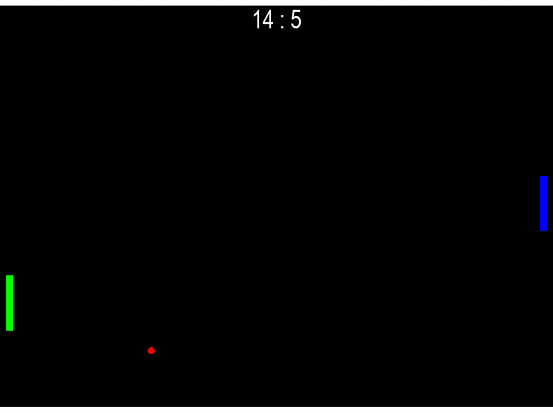

# Pong RL — Deep Q-Learning with MC-Dropout Exploration

> Кастомное окружение Pong на `gymnasium` с ускорением мяча при отбивании краем ракетки + агент на базе DQN с нестандартным механизмом exploration через MC-Dropout (UCB), предобученный имитацией эвристики и дообученный онлайн-RL.

> A custom Pong environment built on `gymnasium`, plus a DQN-based agent with a non-standard exploration mechanism via MC-Dropout (UCB), pretrained by imitating a heuristic and then fine-tuned with online RL.

**Languages / Языки:** [🇷🇺 Русский](#-русский) · [🇬🇧 English](#-english)

<h3 align="center">My_DQN gameplay</h3>
<p align="center">
  
</p>

<h3 align="center">Stable_baselines3 DQN gameplay</h3>
<p align="center">
  
</p>

## 🇷🇺 Русский

### Содержание

- [О проекте](#о-проекте)
- [Цели проекта](#цели-проекта)
- [Что внутри](#что-внутри)
- [Архитектура и ключевые технические решения](#архитектура-и-ключевые-технические-решения)
- [Как запустить](#как-запустить)
- [Результаты](#результаты)
- [Графики обучения](#графики-обучения)
- [Выводы по итогам экспериментов](#выводы-по-итогам-экспериментов)
- [Возможные дальнейшие улучшения](#возможные-дальнейшие-улучшения)

### О проекте

Цель проекта была не просто решить задачу, а спроектировать и опробовать нестандартный подход к exploration в DQN: вместо классического ε-greedy агент использует **MC-Dropout как оценку неопределённости** и выбирает действия по принципу **UCB** (upper confidence bound), балансируя между ожидаемой ценностью действия и уверенностью сети в этой оценке.

### Цели проекта

- Реализовать среду Pong «с нуля» на `gymnasium` с нормализованными наблюдениями, конфигурируемой сложностью соперника и режимом рендеринга.
- Реализовать и обучить DQN-агента, дообучаемого поверх предобучения на эвристике.
- Исследовать **MC-Dropout как источник exploration** в RL (альтернатива ε-greedy) — на практике разобраться, где эта идея работает, а где даёт неожиданные побочные эффекты (нестабильность обучения, коллапс политики).
- Довести агента до обыгрывания бейзлайна и сравнить с эталонной реализацией DQN из `stable-baselines3`.

### Что внутри

| Файл / папка | Назначение |
| --- | --- |
| `env_pong.py` | Кастомное `gymnasium`-окружение Pong: физика мяча/ракеток, нормализованные наблюдения, режимы рендеринга и демо-матчей |
| `models.py` | Игроки: `Baseline` (эвристика — следование за мячом), `HumanPlayer`, `DQN_StBaselines3` (обёртка над `stable-baselines3`), `MyDQN` — основной агент |
| `mydqn_components.py` | `ReplayBuffer` и `Q_network` (MLP с dropout) |
| `pong_mydqn_training&stats.ipynb` | Основной ноутбук обучения: предобучение (behavior cloning) → RL-дообучение → графики метрик (EMA reward, loss history) |
| `pong_game_evaluation.ipynb` | Ноутбук для оценки агентов — загрузка сохранённого чекпоинта из `saved_models/` и прогон обученного агента без рендеринга (только для метрик) |
| `showcase.ipynb` | Ноутбук для визуальной демонстрации — рендер геймплея обученного агента, используется для записи гифок в `gifs/` |
| `pong_datasets/` | Датасет пар (state, action), собранный на эвристике `Baseline`, используется для behavior cloning предобучения `Q_network` |
| `saved_models/` | Сохранённые веса обученных агентов (чекпоинты `MyDQN`), включая лучшую модель по итогам экспериментов |
| `gifs_and_pictures/` | Гифки геймплея — `My_DQN.gif` (кастомный агент) и `Stable_Baselines3_DQN.gif` (эталонная реализация DQN для сравнения). Скриншоты Loss_history и EMA Reward для MyDQN|
| `other/` | История loss (`loss_history`) по обучающим прогонам — сохранена отдельно для построения графиков без повторного запуска обучения |
| `requirements.txt` | Список зависимостей проекта для воспроизведения окружения (`pip install -r requirements.txt`) |
| `.gitignore` | Исключает служебные/временные файлы (`__pycache__`, чекпоинты Jupyter и т.п.) из репозитория |

### Архитектура и ключевые технические решения

**Наблюдение (state):** 6 нормализованных признаков — позиция и скорость мяча по обеим осям, позиции обеих ракеток.

**Действия:** вниз / вверх / стоять.

**Пайплайн обучения:**

1. **Behavior cloning** — предобучение `Q_network` на датасете действий эвристики `Baseline`, чтобы дать агенту разумную стартовую точку и не учить базовым навыкам (следить за мячом) с нуля через RL.
2. **RL fine-tuning (DQN)** — дообучение на взаимодействии со средой:
   - **MC-Dropout UCB exploration** — при выборе действия сеть делает несколько stochastic forward-проходов (dropout включён), из разброса предсказаний считается оценка неуверенности, действие выбирается по `mean_Q + β(t)·std_Q`, где `β(t)` затухает со временем;
   - **ε-greedy поверх UCB** — дополнительный гарантированный источник разнообразия действий на старте обучения;
   - **Double DQN** — снижение систематической переоценки Q-значений;
   - **Soft target update (Polyak averaging)** — плавное обновление target-сети вместо резкой периодической синхронизации;
   - **Reward shaping** — бонус за отбитие мячом ближе к краю ракетки (`0.3 · exp(|alpha|)`, где `alpha` — точка контакта), даёт мячу ускорение, против которого эвристика не успевает реагировать.

### Как запустить

```bash
pip install -r requirements.txt
```

- Обучение с нуля: `pong_mydqn_training&stats.ipynb` (сбор датасета → предобучение → RL-дообучение → графики).
- Инференс на уже обученной модели: `pong_game_evaluation.ipynb`.
- Визуальная демонстрация геймплея: `showcase.ipynb`.

### Результаты

Агент обучен против эвристического бейзлайна (`Baseline(difficult=1)`), который следует за мячом и возвращается к центру поля. Обе модели — и кастомный `MyDQN`, и эталонная реализация на `stable-baselines3` — независимо нашли одну и ту же ключевую стратегию: отбивание мяча краем ракетки, придающее дополнительное ускорение, к которому бейзлайн не успевает адаптироваться. Это подтверждает, что найденная тактика объективно оптимальна против данного соперника, а не артефакт конкретной реализации.

| Метрика | MyDQN (кастомный) | Stable-Baselines3 DQN |
| --- | --- | --- |
| Win rate против `Baseline(difficult=1)` | **26.8%** (110 из 410 розыгрышей) | **62.9%** (300 из 477 розыгрышей) |
| Среднее вознаграждение за розыгрыш | 0.28 | 2.37 |
| Дисперсия вознаграждения | 1.90 | 6.22 |
| Средняя длина розыгрыша | ~421 шаг | ~960 шагов |
| Число шагов обучения (лучший чекпоинт) | 1 800 000 | 1 450 000 |
| Reward shaping | `0.3 · exp(\|alpha\|)`, где `alpha` — точка контакта | тот же |

**Честная оценка:** несмотря на то, что обе модели пришли к одной и той же стратегии, стандартная реализация DQN на `stable-baselines3` заметно превосходит кастомную MC-Dropout-UCB реализацию по итоговому win rate. Матч целиком (серию розыгрышей до `n_rounds` очков) выигрывает только агент из `stable-baselines3`.

### Графики обучения

<figure align="center">
  
  <figcaption style="text-align: justify; padding: 10px 40px 0 40px; max-width: 700px;">
    На графике EMA reward виден постепенный рост со временем, но с периодами спада, которые не исчезают полностью даже на поздних шагах обучения — типичная картина для среды с сильно вариативным reward за розыгрыш в сочетании с exploration, который затухает, но не обнуляется до конца.
  </figcaption>
</figure>
<br><br><br>
<figure align="center">
  
  <figcaption style="text-align: justify; padding: 10px 40px 0 40px; max-width: 700px;">
    График loss показывает характерную гладкую базу с регулярными острыми всплесками на протяжении почти всего обучения. Основные причины разобраны в разделе <a href="#выводы-по-итогам-экспериментов">Выводы по итогам экспериментов</a> — вкратце, это ожидаемый побочный эффект dropout, участвующего в обучении весов (нужен для калибровки MC-Dropout), и нестационарности TD-таргета, свойственной Q-learning в принципе.
  </figcaption>
</figure>


### Выводы по итогам экспериментов

- **Одного MC-Dropout-UCB оказалось недостаточно для надёжного exploration.** После behavior cloning предобучения сеть иногда становилась слишком уверенной в себе ещё до старта RL — маленький разброс между dropout-сэмплами не давал агенту разнообразия действий, что приводило к коллапсу политики. Решение — добавить классический ε-greedy поверх UCB.
- **Vanilla DQN с резкой (hard) синхронизацией target-сети провоцировал колебания метрик** — периоды роста win rate сменялись спадами. **Double DQN** и **soft target update** заметно снизили этот эффект.
- **Reward shaping, который по чистой арифметике выглядел «подозрительно сильным»**, на практике оказался лучшим вариантом — потому что удар по краю ракетки почти гарантированно приносит очко против конкретно этого бейзлайна. Более «мягкие» варианты reward, протестированные из опасения переоптимизации, ни разу не превзошли исходную формулу.
- **Кастомная реализация уступает стандартному DQN из `stable-baselines3`** (26.8% против 62.9% win rate) при общей среде и reward-функции, несмотря на независимо найденную одинаковую стратегию — вероятно, усложнённый механизм exploration (MC-Dropout-UCB) платит потерей стабильности/эффективности за более интересную исследовательскую идею по сравнению с отлаженной стандартной реализацией.
- **Чекпоинты нужно сохранять сразу и часто.** Несколько многообещающих моделей из длинных прогонов в Google Colab были утеряны из-за отсутствия сохранения по ходу обучения.

### Возможные дальнейшие улучшения

- **Ансамбль независимых Q-сетей** (каждая обучается на своём подвыборе батчей) как более честная альтернатива MC-Dropout для оценки неопределённости — разброс предсказаний между независимыми сетями интерпретируется яснее, чем dropout-сэмплирование внутри одной сети. Основное опасение: это ощутимо дороже по вычислениям (N сетей вместо одной на каждом forward/backward проходе), и при выборе действия на каждом шаге среды (как сейчас устроен MC-Dropout-UCB) это могло бы заметно замедлить обучение и рендеринг игры.
- **Prioritized Experience Replay** — сэмплировать переходы для батча не равномерно, а пропорционально их TD-ошибке, чтобы чаще обучаться на редких, но информативных переходах (например, момент удара по краю ракетки), а не тратить вычисления на уже хорошо предсказанные, рутинные шаги.
- Обучение против нескольких уровней сложности эвристики / self-play.

---

## 🇬🇧 English

### Table of Contents

- [About the Project](#about-the-project)
- [Project Goals](#project-goals)
- [Repository Structure](#repository-structure)
- [Architecture and Key Technical Decisions](#architecture-and-key-technical-decisions)
- [How to Run](#how-to-run)
- [Results](#results)
- [Training Curves](#training-curves)
- [Conclusions from the Experiments](#conclusions-from-the-experiments)
- [Possible Future Improvements](#possible-future-improvements)

### About the Project

The goal of this project was not just to solve the task, but to design and test a non-standard approach to exploration in DQN. Instead of classic ε-greedy, the agent uses **MC-Dropout as an uncertainty estimate** and selects actions following the **UCB** (upper confidence bound) principle, balancing the expected value of an action against the network's confidence in that estimate.

### Project Goals

- Implement a Pong environment from scratch on top of `gymnasium`, with normalized observations, configurable opponent difficulty and a rendering mode.
- Implement and train a DQN agent that is fine-tuned on top of pretraining on a heuristic.
- Investigate **MC-Dropout as a source of exploration** in RL (an alternative to ε-greedy) — to find out in practice where this idea works and where it causes unexpected side effects (training instability, policy collapse).
- Bring the agent to the point of beating the baseline and compare it against the reference DQN implementation from `stable-baselines3`.

### Repository Structure

| File / folder | Purpose |
| --- | --- |
| `env_pong.py` | Custom `gymnasium` Pong environment: ball/paddle physics, normalized observations, rendering and demo-match modes |
| `models.py` | Players: `Baseline` (heuristic — follows the ball), `HumanPlayer`, `DQN_StBaselines3` (a wrapper around `stable-baselines3`), `MyDQN` — the main agent |
| `mydqn_components.py` | `ReplayBuffer` and `Q_network` (an MLP with dropout) |
| `pong_mydqn_training&stats.ipynb` | Main training notebook: pretraining (behavior cloning) → RL fine-tuning → metric plots (EMA reward, loss history) |
| `pong_game_evaluation.ipynb` | Agent evaluation notebook — loads a saved checkpoint from `saved_models/` and runs the trained agent without rendering (metrics only) |
| `showcase.ipynb` | Visual demo notebook — renders the trained agent's gameplay; used to record the GIFs in `gifs_and_pictures/` |
| `pong_datasets/` | Dataset of (state, action) pairs collected from the `Baseline` heuristic, used for behavior-cloning pretraining of `Q_network` |
| `saved_models/` | Saved weights of trained agents (`MyDQN` checkpoints), including the best model from the experiments |
| `gifs_and_pictures/` | Gameplay GIFs — `My_DQN.gif` (custom agent) and `Stable_Baselines3_DQN.gif` (reference DQN implementation for comparison), plus screenshots of Loss History and EMA Reward for MyDQN |
| `other/` | Loss history (`loss_history`) for the training runs — stored separately so the plots can be rebuilt without re-running training |
| `requirements.txt` | Project dependencies for reproducing the environment (`pip install -r requirements.txt`) |
| `.gitignore` | Excludes service/temporary files (`__pycache__`, Jupyter checkpoints, etc.) from the repository |

### Architecture and Key Technical Decisions

**Observation (state):** 6 normalized features — the ball's position and velocity along both axes, and the positions of both paddles.

**Actions:** down / up / stay.

**Training pipeline:**

1. **Behavior cloning** — pretraining `Q_network` on a dataset of `Baseline` heuristic actions, to give the agent a sensible starting point and avoid teaching it basic skills (tracking the ball) from scratch through RL.
2. **RL fine-tuning (DQN)** — fine-tuning through interaction with the environment:
   - **MC-Dropout UCB exploration** — when choosing an action, the network makes several stochastic forward passes (dropout enabled); the spread of the predictions gives an uncertainty estimate, and the action is chosen by `mean_Q + β(t)·std_Q`, where `β(t)` decays over time;
   - **ε-greedy on top of UCB** — an additional guaranteed source of action diversity at the start of training;
   - **Double DQN** — reduces systematic overestimation of Q-values;
   - **Soft target update (Polyak averaging)** — smooth updates of the target network instead of abrupt periodic synchronization;
   - **Reward shaping** — a bonus for hitting the ball closer to the paddle's edge (`0.3 · exp(|alpha|)`, where `alpha` is the contact point), which accelerates the ball in a way the heuristic cannot react to in time.

### How to Run

```bash
pip install -r requirements.txt
```

- Training from scratch: `pong_mydqn_training&stats.ipynb` (dataset collection → pretraining → RL fine-tuning → plots).
- Inference with an already trained model: `pong_game_evaluation.ipynb`.
- Visual gameplay demo: `showcase.ipynb`.

### Results

The agent was trained against the heuristic baseline (`Baseline(difficult=1)`), which follows the ball and returns to the center of the field. Both models — the custom `MyDQN` and the reference `stable-baselines3` implementation — independently discovered the same key strategy: hitting the ball with the edge of the paddle, which gives it extra acceleration that the baseline cannot adapt to. This suggests that the discovered tactic is objectively optimal against this opponent, rather than an artifact of a particular implementation.

| Metric | MyDQN (custom) | Stable-Baselines3 DQN |
| --- | --- | --- |
| Win rate vs `Baseline(difficult=1)` | **26.8%** (110 of 410 rallies) | **62.9%** (300 of 477 rallies) |
| Mean reward per rally | 0.28 | 2.37 |
| Reward variance | 1.90 | 6.22 |
| Mean rally length | ~421 steps | ~960 steps |
| Training steps (best checkpoint) | 1,800,000 | 1,450,000 |
| Reward shaping | `0.3 · exp(\|alpha\|)`, where `alpha` is the contact point | same |

**Honest assessment:** even though both models arrived at the same strategy, the standard DQN implementation from `stable-baselines3` clearly outperforms the custom MC-Dropout-UCB implementation in final win rate. Only the `stable-baselines3` agent wins a full match (a series of rallies up to `n_rounds` points).

### Training Curves

<figure align="center">
  
  <figcaption style="text-align: justify; padding: 10px 40px 0 40px; max-width: 700px;">
    The EMA reward plot shows a gradual increase over time, but with dips that do not disappear completely even at late training steps — a typical picture for an environment with highly variable per-rally reward combined with exploration that decays but never fully reaches zero.
  </figcaption>
</figure>
<br><br><br>
<figure align="center">
  
  <figcaption style="text-align: justify; padding: 10px 40px 0 40px; max-width: 700px;">
    The loss plot shows a smooth baseline with regular sharp spikes throughout almost the entire training run. The main causes are discussed in <a href="#conclusions-from-the-experiments">Conclusions from the Experiments</a> — in short, this is an expected side effect of dropout being active during weight training (needed to calibrate MC-Dropout), together with the non-stationarity of the TD target that is inherent to Q-learning in general.
  </figcaption>
</figure>

### Conclusions from the Experiments

- **MC-Dropout-UCB alone turned out to be insufficient for reliable exploration.** After behavior-cloning pretraining, the network sometimes became overconfident even before RL started — a small spread between dropout samples gave the agent no diversity in actions, which led to policy collapse. The fix was to add classic ε-greedy on top of UCB.
- **Vanilla DQN with a hard target-network sync caused oscillating metrics** — periods of rising win rate were followed by drops. **Double DQN** and **soft target updates** noticeably reduced this effect.
- **The reward shaping that looked "suspiciously strong" on pure arithmetic** turned out to be the best option in practice — hitting the ball with the paddle's edge almost guarantees a point against this particular baseline. Softer reward variants, tested out of concern about over-optimization, never outperformed the original formula.
- **The custom implementation falls short of the standard DQN from `stable-baselines3`** (26.8% vs 62.9% win rate) with the same environment and reward function, despite the independently discovered identical strategy — most likely the more complex exploration mechanism (MC-Dropout-UCB) trades some stability/efficiency for a more interesting research idea compared with a well-tuned standard implementation.
- **Checkpoints should be saved immediately and often.** Several promising models from long Google Colab runs were lost because nothing was saved during training.

### Possible Future Improvements

- **An ensemble of independent Q-networks** (each trained on its own subset of batches) as a more principled alternative to MC-Dropout for uncertainty estimation — the spread of predictions across independent networks is easier to interpret than dropout sampling inside a single network. The main concern: it is noticeably more expensive computationally (N networks instead of one on every forward/backward pass), and since an action is selected at every environment step (as MC-Dropout-UCB currently does), this could significantly slow down training and game rendering.
- **Prioritized Experience Replay** — sample transitions for a batch not uniformly but proportionally to their TD error, so the agent learns more often from rare but informative transitions (e.g. the moment of an edge hit) instead of spending compute on routine steps that are already well predicted.
- Training against several heuristic difficulty levels / self-play.
